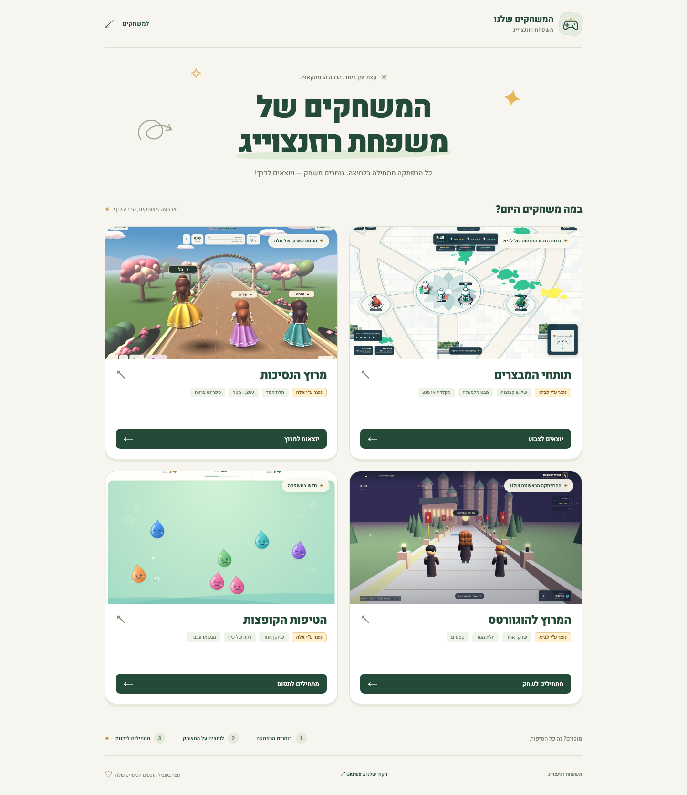
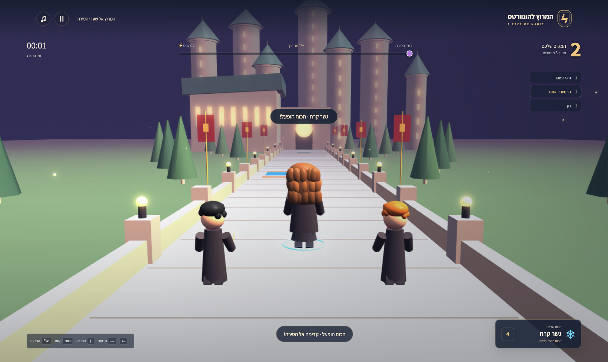
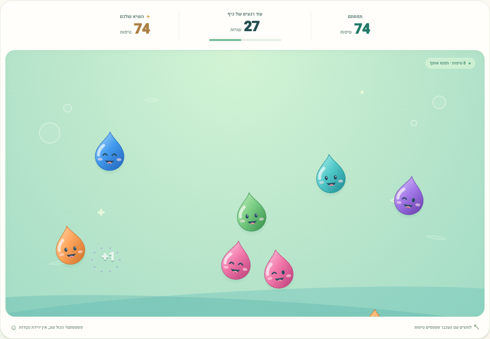
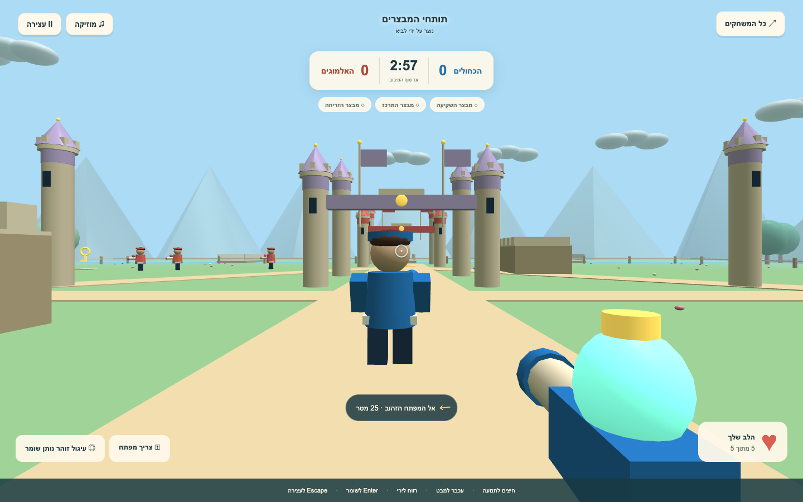
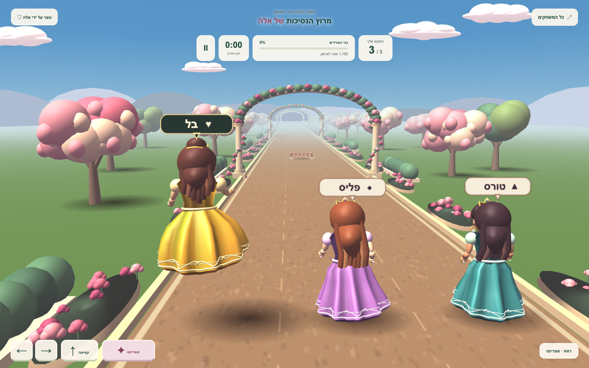

<div align="center">

# 🎮 My kids inventing games

### Their ideas. Their voices. Their games.

**[Play the games →](https://my-kids-inventing-games.hai-rozen.workers.dev/)**

Made by **Lavie (לביא)** and **Ella (אלה)**, with coding agents as their builders.

</div>

The kids independently use their voices to tell coding agents what to build: how a game should look, how it should work, and what they want to change next. They invent the rules, answer the agents’ questions, play the result, and ask for changes. The agents turn their instructions into code.

[](https://my-kids-inventing-games.hai-rozen.workers.dev/)

## 🪄 Lavie’s Hogwarts race

Choose Harry, Hermione, or Ron, draw a magical power, and race the other two characters toward the castle. Use your power to cross obstacles, then face Voldemort before the finish line.

[](https://my-kids-inventing-games.hai-rozen.workers.dev/games/hogwarts/)

**[Play Lavie’s game →](https://my-kids-inventing-games.hai-rozen.workers.dev/games/hogwarts/)** · Arrow keys to move and jump · Space for magic

## 💧 Ella’s jumping droplets

Catch colorful water droplets with funny faces before they disappear. You have one minute, more droplets keep arriving, and your best score stays in your browser.

[](https://my-kids-inventing-games.hai-rozen.workers.dev/games/droplets/)

**[Play Ella’s game →](https://my-kids-inventing-games.hai-rozen.workers.dev/games/droplets/)** · Tap or click · 60 seconds per round

## 🏰 Lavie’s Fortress Cannons — תותחי המבצרים

A three-team paint battle invented by Lavie, seen from above. Join the green team against red and yellow. Each team starts with one of three towers, and all towers can change hands when sprayed with paint. Two automatic cannons start green; rivals can capture them, and friendly paint refills them. The team holding the most towers after three minutes wins.

The 120 × 120 arena has white porcelain paving, eight cover obstacles, three landmark towers, and two cannons. A close overhead camera follows the player, while a minimap shows the entire arena and the current camera footprint. Characters have white bodies with team-colored overalls. The controlled character is larger and has a dark selection ring and an `אני` marker.

[](https://my-kids-inventing-games.hai-rozen.workers.dev/games/fortress-cannons/)

Use **arrow keys or WASD** to move and face a direction, then **Space** to spray paint. The mouse can aim and spray with a click or hold. On-screen direction and spray buttons support touch. **Escape** pauses. After five paint hits, a character returns beside the closest tower their team owns; if none remain, they return to the center. Circles, squares, triangles, and labels identify the teams alongside their colors. Soft original music has a mute button.

The characters have no gender; character customization remains deferred. [The design notes](docs/third-game-design.md) distinguish Lavie’s confirmed rules from developer-selected defaults and preserve the old first-person version’s history. All geometry, game code, and music are original. The game reuses this repository’s bundled Babylon.js runtime and has no dependency on another local repository.

[Verification notes](docs/fortress-cannons-verification.md) distinguish simulation checks, browser interaction, and deployment checks.

**[Play Fortress Cannons →](https://my-kids-inventing-games.hai-rozen.workers.dev/games/fortress-cannons/)**

## 👑 Ella’s princess race

Ella plays as Belle (בל), racing Felice (פליס) and Torres (טורס) through a 3D royal garden. The 1,200-metre course passes rose gardens, a lakeside promenade, and the palace approach. A complete race takes roughly 100–115 seconds in deterministic full-race checks. Belle moves forward automatically: left/right arrows steer, up jumps, and holding Space activates sprint. On-screen buttons support touch.

The longer route has 25 spaced obstacles. Bumping one slows the racer briefly. The first princess across the finish line gets a sign with her name and fireworks, then the race can be played again.

[](https://my-kids-inventing-games.hai-rozen.workers.dev/games/princess-race/)

This is an independent game with original artwork and rules, using the repository's bundled Babylon.js engine. [The glossary](GLOSSARY.md) records each child's characters and game terms in separate sections. [Verification notes](tests/princess-race/README.md) distinguish current checks from the original version's history.

**[Play the princess race →](https://my-kids-inventing-games.hai-rozen.workers.dev/games/princess-race/)**

## 🛠 Run locally

Use Node.js 26.12.0 (`.nvmrc`, managed with mise).

```sh
npm ci
npm run dev
```

Open [localhost:4173](http://127.0.0.1:4173/). Set `PORT` to choose another port.

```sh
npm run check
npm test
```

The games use plain HTML, CSS, and JavaScript. Hogwarts, Fortress Cannons, and Princess Race share the local Babylon.js runtime bundled under Hogwarts' vendor directory. There is no game backend or database. Game text is in Hebrew, with right-to-left layouts and a home button in each game.

## 🗂 Find your way around

| Location | What’s inside |
| --- | --- |
| `public/` | Family game hub and shared screenshots |
| `public/games/hogwarts/` | Lavie’s 3D racing game |
| `public/games/droplets/` | Ella’s droplet-catching game |
| `public/games/fortress-cannons/` | Lavie’s fortress paint game |
| `public/games/princess-race/` | Ella’s princess race |
| `tests/` | Deterministic game model and simulation tests |
| [GLOSSARY.md](GLOSSARY.md) | Separate game vocabularies for Lavie and Ella |
| `docs/` | Fortress Cannons design decisions and historical verification |
| [AGENTS.md](AGENTS.md) | Guidance for agents working with the children |
| [CLAUDE.md](CLAUDE.md) | Imports the shared repository guidance from AGENTS.md |
| `wrangler.jsonc` | Personal Cloudflare Worker configuration |

Browser scenarios in [tests/hogwarts/browser](tests/hogwarts/browser/README.md) are separate from the model tests. Passing model tests does not establish browser or real-device coverage.

The [Fortress Cannons verification](docs/fortress-cannons-verification.md) and [princess race verification](tests/princess-race/README.md) preserve their original local checks from November 13, 2026. Both games were subsequently deployed with the four-game hub on November 14, 2026; the combined 49 tests passed, all four live pages loaded, and both new games started and paused in browser checks.

## ☁️ Deploy to Cloudflare

The live Worker is **[my-kids-inventing-games](https://my-kids-inventing-games.hai-rozen.workers.dev/)**. It serves `public/` directly; unknown URLs return 404.

```sh
npx wrangler login
npx wrangler whoami
npm run preview
npm run deploy
```

Before deploying a fork, change the Worker name and account ID in `wrangler.jsonc` to your own. The account ID is an identifier, not a credential. Wrangler keeps OAuth credentials outside this repository. Never commit credentials or secret values.

`npm run deploy` runs syntax checks and game tests before uploading. GitHub pushes do not automatically deploy. Existing Sites deployments are retained. Best scores are stored per browser and website origin, so they do not transfer from the old host.

## 🔎 Discovery

The website includes `robots.txt`, a sitemap, canonical URLs, and sharing metadata. These help crawlers discover the games; search engines decide whether and when to index them. GitHub manages crawling of repository pages itself; a repository’s own `robots.txt` cannot control github.com.

## ✨ Credits

**Game concepts and creative direction: Lavie and Ella.** Implementation assistance: coding agents.

These are original stylized fan-game visuals. Harry Potter names and the fictional world, and Disney’s Belle, belong to their respective rights holders. This project is not affiliated with or endorsed by them. The bundled Babylon.js runtime retains its [Apache 2.0 license](public/games/hogwarts/vendor/BABYLON-LICENSE.md). No project-wide open-source license has been selected yet; public visibility alone does not grant a general reuse license.
