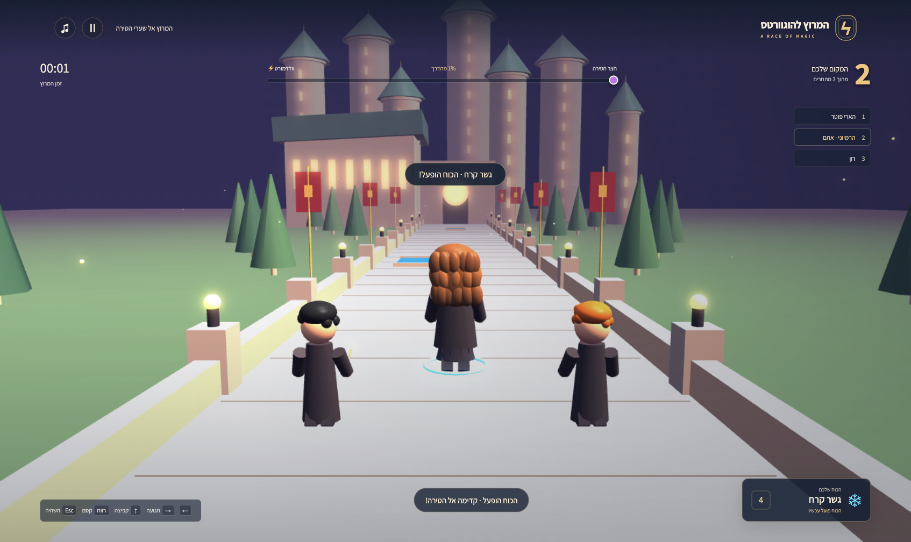
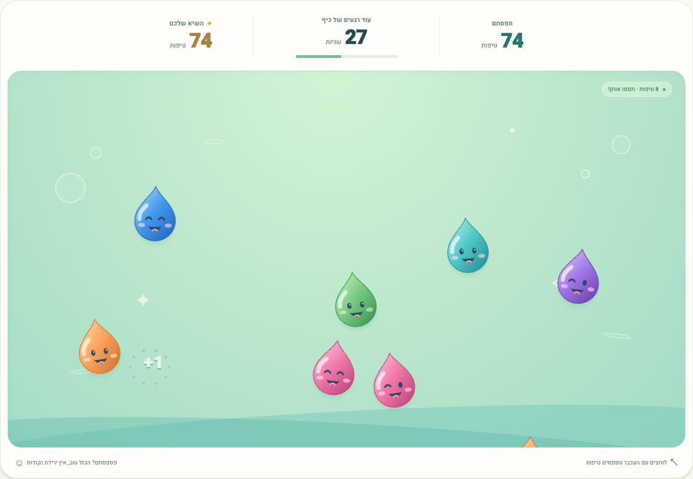

<div align="center">

# 🎮 My kids inventing games

### Their ideas. Their voices. Their games.

**[Play the games →](https://my-kids-inventing-games.hai-rozen.workers.dev/)**

Made by **Lavie (לביא)** and **Ella (אלה)**, with coding agents as their builders.

</div>

The kids independently use their voices to tell coding agents what to build: how a game should look, how it should work, and what they want to change next. They invent the rules, answer the agents’ questions, play the result, and ask for changes. The agents turn their instructions into code.

## 🪄 Lavie’s Hogwarts race

Choose Harry, Hermione, or Ron, draw a magical power, and race the other two characters toward the castle. Use your power to cross obstacles, then face Voldemort before the finish line.

[](https://my-kids-inventing-games.hai-rozen.workers.dev/games/hogwarts/)

**[Play Lavie’s game →](https://my-kids-inventing-games.hai-rozen.workers.dev/games/hogwarts/)** · Arrow keys to move and jump · Space for magic

## 💧 Ella’s jumping droplets

Catch colorful water droplets with funny faces before they disappear. You have one minute, more droplets keep arriving, and your best score stays in your browser.

[](https://my-kids-inventing-games.hai-rozen.workers.dev/games/droplets/)

**[Play Ella’s game →](https://my-kids-inventing-games.hai-rozen.workers.dev/games/droplets/)** · Tap or click · 60 seconds per round

## 🛠 Run locally

Use Node.js 26.12.0 (`.nvmrc`, managed with mise).

```sh
npm ci
npm run dev
```

Open [localhost:4173](http://127.0.0.1:4173/). Set `PORT` to choose another port.

```sh
npm run check
npm test
```

The games use plain HTML, CSS, and JavaScript. Hogwarts includes a local Babylon.js runtime. There is no game backend or database. Game text is in Hebrew, with right-to-left layouts and a home button in each game.

## 🗂 Find your way around

| Location | What’s inside |
| --- | --- |
| `public/` | Family game hub and shared screenshots |
| `public/games/hogwarts/` | Lavie’s 3D racing game |
| `public/games/droplets/` | Ella’s droplet-catching game |
| `tests/` | 28 deterministic game model and simulation tests |
| [AGENTS.md](AGENTS.md) | Guidance for agents working with the children |
| `wrangler.jsonc` | Personal Cloudflare Worker configuration |

Browser scenarios in [tests/hogwarts/browser](tests/hogwarts/browser/README.md) are separate from the model tests. Passing model tests does not establish browser or real-device coverage.

## ☁️ Deploy to Cloudflare

The live Worker is **[my-kids-inventing-games](https://my-kids-inventing-games.hai-rozen.workers.dev/)**. It serves `public/` directly; unknown URLs return 404.

```sh
npx wrangler login
npx wrangler whoami
npm run preview
npm run deploy
```

Before deploying a fork, change the Worker name and account ID in `wrangler.jsonc` to your own. The account ID is an identifier, not a credential. Wrangler keeps OAuth credentials outside this repository. Never commit credentials or secret values.

`npm run deploy` runs syntax checks and game tests before uploading. GitHub pushes do not automatically deploy. Existing Sites deployments are retained. Best scores are stored per browser and website origin, so they do not transfer from the old host.

## 🔎 Discovery

The website includes `robots.txt`, a three-page sitemap, canonical URLs, and sharing metadata. These help crawlers discover the games; search engines decide whether and when to index them. GitHub manages crawling of repository pages itself; a repository’s own `robots.txt` cannot control github.com.

## ✨ Credits

**Game concepts and creative direction: Lavie and Ella.** Implementation assistance: coding agents.

These are original stylized fan-game visuals. Harry Potter names and the fictional world belong to their respective rights holders. This project is not affiliated with or endorsed by them. The bundled Babylon.js runtime retains its [Apache 2.0 license](public/games/hogwarts/vendor/BABYLON-LICENSE.md). No project-wide open-source license has been selected yet; public visibility alone does not grant a general reuse license.
